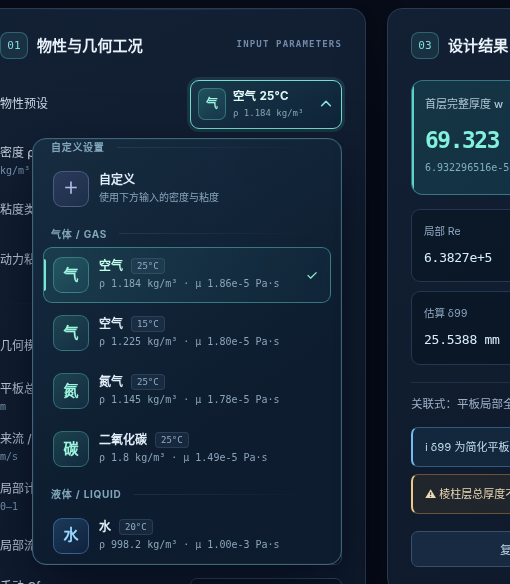

# Prism Layer Studio

**v2.6.0 · 面向 STAR-CCM+ 棱柱层网格初始设计的离线计算工具。**

Offline prism-layer design calculator for STAR-CCM+, with a Windows desktop application and a browser-based interface. The calculation engine, interface, mathematical assumptions, and interactive mesh preview from v2.6 are preserved.

Prism Layer Studio 从目标 y⁺ 和局部流场条件估计首层完整厚度，辅助选择层数、层间增长率及总厚度，并支持利用求解器实测 Wall Y⁺ 进行一次比例校准。所有计算在本机完成，无需账号、云服务器、在线字体或数学排版 CDN。

## 功能

- 深蓝色工程工作台，交互式 SVG 棱柱层模型，支持鼠标跟随、选层、键盘和动画暂停。
- v2.6 分组流体物性预设、动力/运动粘度转换，以及输入校验。
- 正向计算、反求最少整数层数、反求增长率、实测 Wall Y⁺ 校准。
- 平板外流、光滑圆管 Fanning 摩擦关系、翼型局部平板近似。
- 层厚图表、分层数据、STAR-CCM+ 参数摘要、剪贴板复制与 CSV/JSON 导出。
- 可折叠的 15 条 MathML 公式及适用范围说明，完全离线显示。



## 下载与使用

普通用户请进入本仓库的 **Releases** 页面，下载对应版本的安装程序或完整离线便携包：

- `PrismLayerStudio-Setup.exe`：Windows 安装程序，内含微软官方 WebView2 独立离线安装器。
- `PrismLayerStudio-2.6.0-Portable-Offline-x64.zip`：完整离线便携包，解压后运行。

不要把 GitHub 自动生成的 **Source code** 压缩包当作已编译的软件安装包。若尚未创建 Release，请使用下面的源码运行或构建方式。

桌面目标平台为 **Windows 10 1809 或更新版本 / Windows 11 x64**，需要系统 .NET Framework 4.6.2+ 和 WebView2 Runtime 109+；安装版按需使用内置离线运行时安装器。最终用户不需要安装 Python 或 Node.js。

详细说明见 [简体中文用户指南](USER_GUIDE.zh-CN.md)。

## 从源码运行

浏览器方式：直接打开 [`app/index.html`](app/index.html)，或同源单文件版 [`publish/index.html`](publish/index.html)。使用支持原生 MathML 的现代浏览器。

Windows 桌面开发方式：

```powershell
python -m venv .venv-build
.\.venv-build\Scripts\python.exe -m pip install -r requirements-build.txt
.\.venv-build\Scripts\python.exe desktop.py
```

`app/` 是正式页面源码。`desktop.py` 使用 pywebview 与本机回环资源服务创建独立窗口，`desktop_bridge.js` 负责桌面文件保存、剪贴板及 WebView2 兼容适配。

## 构建和测试

Windows x64 构建环境推荐官方 CPython 3.13.7；数值测试需要 Node.js 20+。依赖版本固定在 [`requirements-build.txt`](requirements-build.txt)。首次构建需要联网获取构建依赖和锁定的微软安装器，软件运行与完整离线安装不依赖互联网。

```bat
test.bat
build.bat
build-installer.bat
test.bat --packaged
```

产物输出到 `release/`。重建说明见 [BUILD_GUIDE.md](BUILD_GUIDE.md)，GitHub 上传及 Release 发布步骤见 [GITHUB_PUBLISH_GUIDE.zh-CN.md](GITHUB_PUBLISH_GUIDE.zh-CN.md)。

此前 Windows 11 本机测试通过了 13 项数值测试、21 项 Python 测试、四档渲染缩放共 76 项打包 EXE 检查，以及中文路径安装/运行/卸载。具体范围与尚未验证项见 [TEST_REPORT.md](TEST_REPORT.md)；这些是历史本机结果，不代表 GitHub Actions 已执行或其他 Windows 环境已验收。

## 计算假设

输出用于网格初始设计。预测 y⁺ 不等于 CFD 求解器实测 Wall Y⁺；外流采用局部表面摩擦系数，管流采用 Fanning 摩擦因子；首层质心距墙按完整厚度的一半近似。翼型模式使用局部平板关系，表面选项仅作标记，不求解压力梯度、分离或真实转捩。比例校准后仍须重新划分网格、求解并复测。完整公式和假设保留在应用第 06 节。

## 开源与贡献

本项目自有代码及原始资产采用 [MIT License](LICENSE)。第三方依赖分别适用其原始许可证，详见 [THIRD_PARTY_NOTICES.md](THIRD_PARTY_NOTICES.md) 和 [`licenses/`](licenses/)。Microsoft WebView2 Runtime 不因本项目采用 MIT 而变为 MIT 授权软件。

提交问题或修改前请阅读 [CONTRIBUTING.md](CONTRIBUTING.md)。本工具与 Siemens 无隶属关系，不表示 STAR-CCM+ 官方认可或认证。
